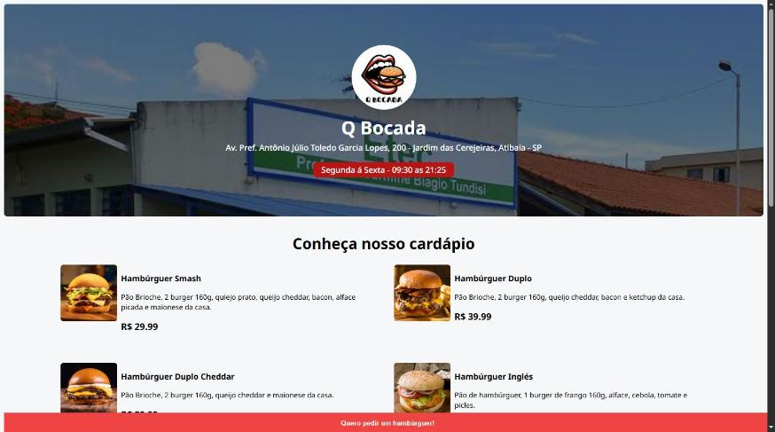

# Q Bocada




> Website for Q Bocada, a burger restaurant: a digital menu for customers and a simple expense tracker for the owner.

🔗 **Live demo:** [q-bocada.vercel.app](https://q-bocada.vercel.app)

## ✅ Features

- [x] Login page with show/hide password
- [x] Digital menu with burgers, ingredients and prices
- [x] WhatsApp order button
- [x] Expense tracker for the owner: income, expenses, totals and balance
- [x] Expense data saved with localStorage

## 🛠 Technologies

   

## 💻 Prerequisites

Before you begin, make sure you have:

- A modern web browser (Chrome, Firefox, Edge or Safari)
- [Git](https://git-scm.com/) installed

## 🚀 Installing Q Bocada

To install Q Bocada, follow these steps:

Linux and macOS:

```bash
git clone https://github.com/NathanCarvalhodaCunha/Q-Bocada.git
cd Q-Bocada
```

Windows:

```powershell
git clone https://github.com/NathanCarvalhodaCunha/Q-Bocada.git
cd Q-Bocada
```

## ☕ Using Q Bocada

To use Q Bocada, follow these steps:

Open `index.html` in your browser, or use the live demo. Customers are taken to the menu (`cardapio.html`) after logging in, and the owner is taken to the expense tracker (`despesas.html`).

> ⚠️ The login is a front-end demo that only redirects between pages. It is not real authentication.

## 📁 Project structure

```
├── index.html      # login
├── cardapio.html   # menu
├── despesas.html   # expense tracker
├── CSS/
├── JS/
└── Imagens/
```

## 📫 Contributing to Q Bocada

To contribute to Q Bocada, follow these steps:

1. Fork this repository.
2. Create a branch: `git checkout -b <branch_name>`.
3. Make your changes and commit them: `git commit -m '<commit_message>'`
4. Push to the original branch: `git push origin <branch_name>`
5. Create the pull request.

Alternatively, see the GitHub documentation on [creating a pull request](https://docs.github.com/en/pull-requests/collaborating-with-pull-requests/proposing-changes-to-your-work-with-pull-requests/creating-a-pull-request).

## 🤝 Contributors

<table>
  <tr>
    <td align="center">
      <a href="https://github.com/NathanCarvalhodaCunha" title="Nathan Carvalho da Cunha on GitHub">
        <br>
        <sub>
          <b>Nathan Carvalho da Cunha</b>
        </sub>
      </a>
    </td>
  </tr>
</table>
